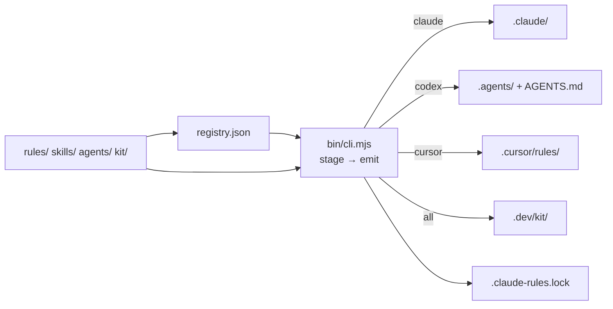

# Architecture — claude-rules

> Source PRD: none — the vision and goals live in [`README.md`](../README.md).
> Shared decisions: none
> RFC store: GitHub issues — see [§ RFC store](#rfc-store)

## Shape & profiles

- **Shape**: a CLI plus the asset library it installs — no service, no frontend.
- **Installed profiles**: none. This repository does not install itself; how it runs its
  own skills and kit (symlinks, not copies) is a separate RFC, not yet written.

## System shape

The library is Markdown and kit files under `rules/`, `skills/`, `agents/` and `kit/`.
`registry.json` maps profiles to those paths. `bin/cli.mjs` stages the paths a consuming
repo's profiles select, then per-agent emitters write them into that repo (ADR-0003) and
pin the choice in `.claude-rules.lock`. The consuming repo owns what it receives.

ADR-0008 (Accepted, not yet built) replaces the single GitHub source with ordered git
sources merged into one staged tree before emitting.

## Technology stack

| Layer | Choice | Why (1 line) | ADR |
|-------|--------|--------------|-----|
| Installer runtime | Node.js ≥ 18, ESM, no build step | runs through `npx` with nothing to compile | — |
| Installer dependencies | `giget` only, removed by ADR-0008 for `git` | a dumb, data-driven CLI with no dependency tree | ADR-0008 |
| Emission targets | Claude Code and Codex by default, Cursor optional | one authored source, explicit routing limits | ADR-0003 (supersedes the scope of ADR-0001) |
| Assets | Markdown with YAML frontmatter; kit in shell, Node and `just` | read by agents as is; copied, owned, pinned | — |
| Quality gates (shipped) | `just` recipes + `lefthook`; mutation as a PR gate | one gate entry point per repo | ADR-0002 |
| Tests | `node:test`, no dependency, no network; toolchain jalons gated by env | every PR runs the suite offline | — |
| Agent regression | `eval/`, calls `claude`, manual | spends tokens: model bumps only | — |
| CI | GitHub Actions (`.github/workflows/ci.yml`) | the forge this repository lives on | — |
| Execution doctrine | per-run autonomy levels, the RFC as the only path, L4 delegation | how agents run work in consuming repos | ADR-0004, ADR-0007, ADR-0009 |

## Data

No store. The state a consuming repo keeps is `.claude-rules.lock` (profiles, agents,
modules, levels, the Codex ownership inventory) and the emitted files. Working memory
lives in `.work/<slug>/` and is committed (`rules/product/documents.md`).

## Cross-cutting concerns

- **Ownership**: the installer never merges build config; kit wiring is manual
  (`CLAUDE.md`). Codex files carry hashes in the lock; Claude and Cursor copies are
  replaced.
- **Safety**: every write goes through `safePath` (no escape, no symlinked destination).
- **Decisions**: ADRs only for cross-feature arbitrations (ADR-0005).

## Boundaries & third parties

| Boundary | Contract | If it fails |
|---|---|---|
| GitHub (assets) | `github:dohrm/claude-rules` at a ref via `giget`; raw endpoint for file entries | `add`/`update` fail before writing anything |
| `npx` | runs `bin/cli.mjs` from the package at `#<ref>` | no install |
| Agent harnesses (Claude Code, Codex, Cursor) | their on-disk layouts for rules, skills, agents | assets land but are not loaded |

## RFC store

- Tracker: GitHub issues, `dohrm/claude-rules`
- Access: `gh` (`gh issue view|edit|comment`, `gh api` for the timeline); whoami:
  `gh api user -q .login`
- Agent accounts: none — the agent acts as whoever `gh` is authenticated as, a human's
  account. Every agent comment starts with `🤖 … on behalf of <whoami>`, and an agent
  never sets `rfc:ready`.
- Status: labels `rfc:draft`, `rfc:ready`, `rfc:implementing`, `rfc:done`
- Who set ready: the issue timeline's actor on the `rfc:ready` label — a human's
  account like the agent's here, so the guard is the agent's own: it never adds that label

## Decision log

- [ADR-0001](./adr/0001-emission-targets-claude-and-cursor.md) — Emission targets are Claude Code and Cursor (Proposed; its scope was taken over by ADR-0003)
- [ADR-0002](./adr/0002-mutation-is-a-pr-gate.md) — Mutation testing is a PR gate
- [ADR-0003](./adr/0003-claude-codex-sharing.md) — Share source assets across Claude Code and Codex
- [ADR-0004](./adr/0004-autonomy-levels.md) — Per-run autonomy levels, defaulting to guided
- [ADR-0005](./adr/0005-adr-scope-and-decision-homes.md) — ADRs for cross-feature arbitrations only
- [ADR-0006](./adr/0006-feature-rfc-execution-path.md) — Iterated feature RFC (Superseded by ADR-0007)
- [ADR-0007](./adr/0007-rfc-only-execution-path.md) — The feature RFC is the only execution path
- [ADR-0008](./adr/0008-layered-sources.md) — Install from layered sources, last path wins
- [ADR-0009](./adr/0009-l4-delegated-checkpoints.md) — L4 delegates named checkpoints inside a verified domain
